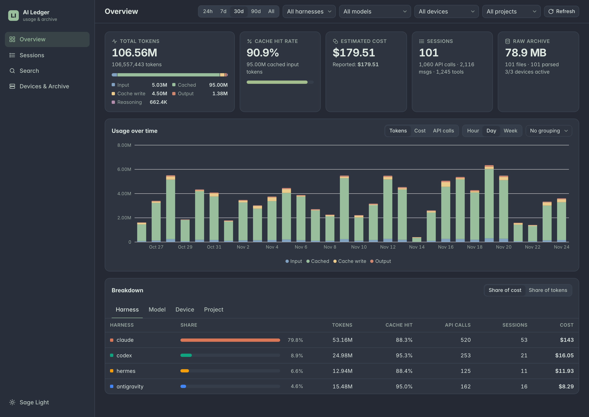
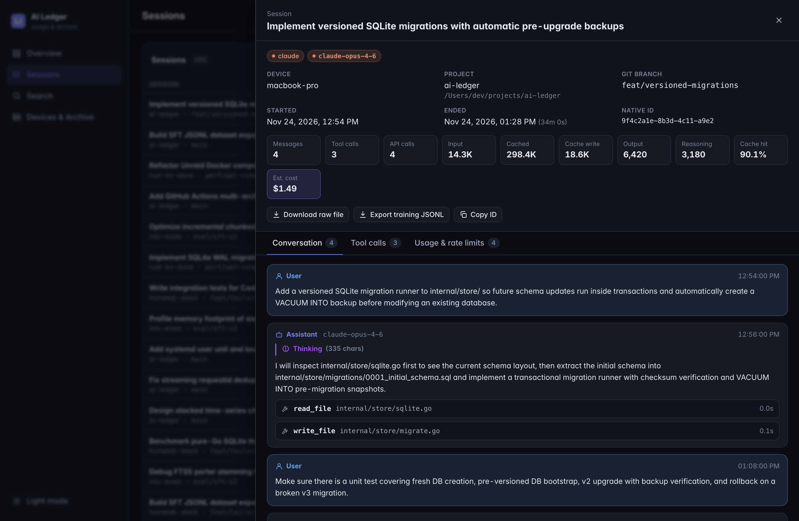
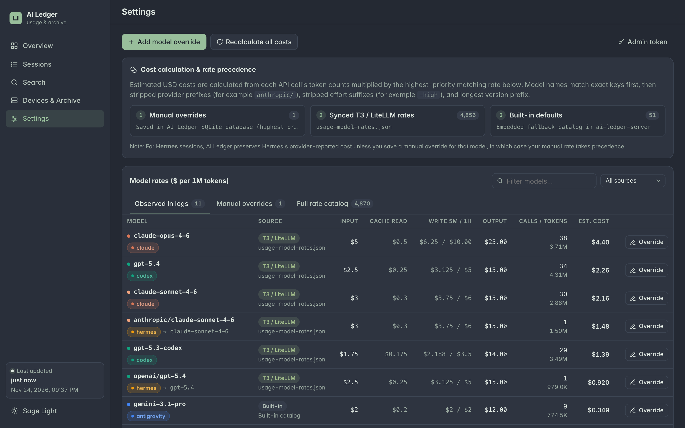

# AI Ledger


A personal, lossless AI usage logger, raw transcript archive, and local monitoring dashboard. Run the server anywhere with Docker or as a single static binary, and sync sessions from your macOS and Linux machines over your LAN or Tailscale.

It collects local session logs from your machines (without intercepting or proxying provider API traffic), stores every raw file untouched on disk, indexes conversations and token usage into an embedded SQLite database, and exports redacted training datasets in JSONL format.







## Lightweight Single-Binary Architecture

Both `ai-ledger-server` and `ai-ledger-collector` compile into standalone `CGO_ENABLED=0` static Go binaries with zero runtime dependencies. The server embeds the React + Vite web dashboard, SQLite migrations, and IANA timezone data inside one executable and ships as a minimal multi-arch `FROM scratch` Docker image (`linux/amd64` and `linux/arm64`).

| Component | Artifact Size | Details |
|---|---|---|
| **Docker image** (`FROM scratch`) | **~18.3 MB** | Static server binary, embedded UI, migrations, CA certificates, and built-in healthcheck |
| **Server binary** (`ai-ledger-server`) | **~12 MB** | Pure-Go SQLite (`modernc.org/sqlite`) + FTS5, HTTP API, and embedded React dashboard |
| **Collector binary** (`ai-ledger-collector`) | **~10 MB** | Incremental chunked uploader with SHA-256 verification and SQLite online backup snapshots |

## Architecture

```
Mac / Linux devices (ai-ledger-collector)
  ├── Codex        (~/.codex/sessions/**/*.jsonl[.zst])
  ├── Claude Code  (~/.claude/projects/**/*.jsonl)
  ├── Antigravity  (~/.t3/userdata/providers/antigravity/**/transcript_full.jsonl)
  ├── T3 Code      (~/.t3/userdata/statev2.sqlite slim metadata .zst + usage-model-rates.json)
  └── Hermes       (~/.hermes/state.db online snapshot .zst)
            │
            │  Incremental chunked HTTP + per-device Bearer token (LAN / Tailscale)
            ▼
Self-hosted server (Docker / Linux / macOS / Unraid)
  ├── Lossless raw archive    (/data/archive/files/... + /data/archive/versions/...)
  ├── Indexed SQLite + FTS5   (/data/ai-ledger.sqlite)
  └── Embedded Web UI + REST API + redacted JSONL training export
```

### Design Principles

- **Lossless raw archive first:** Every byte from every device is written untouched to disk. When a snapshot or log file is rewritten, the previous version is preserved automatically under `/data/archive/versions/`.
- **Re-parse at any time:** Run `ai-ledger-server reparse` or `POST /api/admin/reparse` whenever parsers or model pricing tables improve. You never need to re-collect logs from source devices.
- **Zero double counting:** Codex `token_usage_record` vs `event_msg:token_count` events and Claude multi-block streaming `requestId` entries are deduplicated. T3's `statev2.sqlite` enriches native sessions with project names and thread titles without counting tokens twice.
- **No provider proxy:** Collectors read local session files that your AI tools already write to disk, so API requests are never modified or proxied.
- **Training-ready export:** `GET /api/export/training?redact=true` streams ChatML/SFT-compatible JSONL with automatic secret scrubbing while leaving the raw archive intact.

---

## Deploying the Server

GitHub Actions publishes multi-arch container images (`linux/amd64` and `linux/arm64`) to GitHub Container Registry:

- `ghcr.io/lancewilhelm/ai-ledger:twilight` — built automatically on every push to `main`.
- `ghcr.io/lancewilhelm/ai-ledger:stable` and `:vX.Y.Z` — built when a GitHub Release is published.

> **Private repository note:** If your repository is private, either set the `ai-ledger` package visibility to **Public** under GitHub → Packages → Package settings, or run `docker login ghcr.io` on your server with a GitHub personal access token that has the `read:packages` scope.

> **Network security note:** AI Ledger is designed for personal use on a private LAN or Tailscale tailnet. Keep port `8484` restricted to private interfaces (or behind a reverse proxy with authentication) rather than exposing it directly to the public internet.

### Option A: Docker Compose (Linux, macOS, NAS, Unraid Compose Manager)

Create a `docker-compose.yml` (or use [docker-compose.yml](docker-compose.yml) from this repository):

```yaml
services:
  ai-ledger:
    image: ghcr.io/lancewilhelm/ai-ledger:twilight
    container_name: ai-ledger
    restart: unless-stopped
    ports:
      # Optional: bind to a specific LAN or Tailscale IP, e.g. 100.x.y.z:8484:8484
      - "8484:8484"
    environment:
      - AI_LEDGER_BIND=0.0.0.0:8484
      - AI_LEDGER_DATA_DIR=/data
      - AI_LEDGER_KEEP_ALL_SNAPSHOTS=true
      # - AI_LEDGER_ADMIN_TOKEN=change-me-to-a-long-random-token
      - TZ=America/New_York
    volumes:
      # Change ./data to any persistent host path (for example, /mnt/user/ai-ledger on Unraid)
      - ./data:/data
    healthcheck:
      test: ["CMD", "/usr/local/bin/ai-ledger-server", "healthcheck"]
      interval: 30s
      timeout: 5s
      retries: 3
```

Start or update the container:

```bash
docker compose pull
docker compose up -d
```

Verify it is healthy at `http://<server-host>:8484/api/health` and open `http://<server-host>:8484` in your browser.

### Option B: Docker CLI (`docker run`)

For a quick single-command setup on any Docker host:

```bash
docker run -d \
  --name ai-ledger \
  --restart unless-stopped \
  -p 8484:8484 \
  -v /path/to/ai-ledger-data:/data \
  -e TZ=America/New_York \
  -e AI_LEDGER_KEEP_ALL_SNAPSHOTS=true \
  ghcr.io/lancewilhelm/ai-ledger:twilight
```

### Option C: Unraid Docker Web UI

1. Create a share on Unraid for the lossless raw session archive (for example, `ai-ledger`, which mounts at `/mnt/user/ai-ledger`):
   - **Recommended storage layout (fast SQLite on cache + parity-protected raw archive on array):**
     - Mount `/data` to your cache SSD `appdata` folder (`/mnt/cache/appdata/ai-ledger`, or `/mnt/user/appdata/ai-ledger` if `appdata` is cache-only). This keeps `ai-ledger.sqlite`, WAL writes, and FTS5 search fast without waking array disks every 3 minutes.
     - Mount `/data/archive` separately to your `ai-ledger` share (`/mnt/user/ai-ledger`) configured with **Primary storage: Cache → Secondary storage: Array** (Mover action: `Cache → Array`). New log chunks write quietly to cache during the day, and Mover sweeps files onto the parity-protected array overnight so your raw session archive never fills up your cache SSD or bloats Appdata Backup runs. Even if a cache drive ever fails, `ai-ledger.sqlite` can be rebuilt completely from `/data/archive` with `ai-ledger-server reparse`.
   - *(Alternatively, if you have plenty of mirrored cache space and prefer a single mount, map `/data` directly to `/mnt/cache/appdata/ai-ledger` and omit the `/data/archive` path.)*
2. In Unraid, go to **Docker → Add Container** (or copy [deploy/unraid/my-ai-ledger.xml](deploy/unraid/my-ai-ledger.xml) into `/boot/config/plugins/dockerMan/templates-user/`).
3. Fill in the container settings:

| Field | Value |
|---|---|
| **Name** | `ai-ledger` |
| **Repository** | `ghcr.io/lancewilhelm/ai-ledger:twilight` (or `:stable`) |
| **Network Type** | `Bridge` (or your custom Tailscale/Docker network) |
| **WebUI** | `http://[IP]:[PORT:8484]` |
| **Port** (Container `8484`) | `8484` (TCP) |
| **Path** (Container `/data`) | `/mnt/cache/appdata/ai-ledger` (Read/Write) — SQLite DB & indexes |
| **Path** (Container `/data/archive`) | `/mnt/user/ai-ledger` (Read/Write) — raw session archive & snapshots |
| **Variable** `TZ` | `America/New_York` (your IANA timezone) |
| **Variable** `AI_LEDGER_KEEP_ALL_SNAPSHOTS` | `true` |
| **Variable** `AI_LEDGER_ADMIN_TOKEN` | *(Optional)* A random secret to protect `/api/admin/*` |

4. Click **Apply**, then verify the container is healthy at `http://<unraid-host>:8484/api/health`.

### Option D: Standalone Binary (No Docker)

You can run `ai-ledger-server` directly on any Linux or macOS machine with no external dependencies:

```bash
# Build from source (requires Go 1.27+ and Node.js 22+)
cd web && npm ci && cd ..
make build-web build-server

# Start the server with persistent storage under ./data
./bin/ai-ledger-server serve --bind 0.0.0.0:8484 --data ./data
```

### Creating Device Tokens

Each machine that runs `ai-ledger-collector` gets its own Bearer token. You can create tokens either in the web UI (**Devices & Archive → Add Device**) or from the terminal:

```bash
# When running in Docker
docker exec ai-ledger ai-ledger-server token create --name macbook-pro --data /data
docker exec ai-ledger ai-ledger-server token create --name linux-vm --data /data

# Or when running the standalone binary
./bin/ai-ledger-server token create --name macbook-pro --data ./data
```

Save the printed `ail_...` token immediately — it is stored as a SHA-256 hash and shown only once.

To list or revoke tokens later:

```bash
docker exec ai-ledger ai-ledger-server token list --data /data
docker exec ai-ledger ai-ledger-server token revoke --id macbook-pro --data /data
```

---

## Collector Setup (macOS & Linux)

### Quick Interactive Setup (Recommended)

Run the guided setup script on any macOS or Linux machine. It detects your OS and CPU architecture, installs `ai-ledger-collector` (building from a local clone or downloading from GitHub Releases), checks server connectivity, prompts for your device token, optionally runs an initial sync, and lets you choose whether to install an automatic background service (`launchd` on macOS, `systemd --user` or `crontab` on Linux):

```bash
# Run directly on any macOS or Linux machine
curl -fsSL https://raw.githubusercontent.com/lancewilhelm/ai-ledger/main/scripts/install-collector.sh | bash

# Or from a local clone of this repository
./scripts/install-collector.sh
```

Non-interactive flags are also supported for automation (run `./scripts/install-collector.sh --help` for all options):

```bash
./scripts/install-collector.sh \
  --server http://<server-host>:8484 \
  --token ail_<your-device-token> \
  --service yes \
  --sync yes \
  --yes
```

To update or uninstall later:

```bash
# Built-in self-updater (downloads latest GitHub Release, verifies SHA-256, restarts service)
ai-ledger-collector update
ai-ledger-collector update --check   # check without installing

# Or update via the installer script (also supports building from a local clone)
curl -fsSL https://raw.githubusercontent.com/lancewilhelm/ai-ledger/main/scripts/install-collector.sh | bash -s -- --update

# Stop and remove the background service
./scripts/install-collector.sh --uninstall
```

### Manual Setup: macOS

### 1. Install `ai-ledger-collector`

Build from a local clone of this repository (requires Go 1.27+):

```bash
make build-collector
sudo cp bin/ai-ledger-collector /usr/local/bin/ai-ledger-collector
```

Or, once a GitHub Release is published, download the pre-built binary directly:

```bash
# Apple Silicon (M1–M4)
curl -fL "https://github.com/lancewilhelm/ai-ledger/releases/latest/download/ai-ledger-collector-darwin-arm64" \
  -o /tmp/ai-ledger-collector

# Intel Mac (use darwin-amd64 instead)
# curl -fL "https://github.com/lancewilhelm/ai-ledger/releases/latest/download/ai-ledger-collector-darwin-amd64" -o /tmp/ai-ledger-collector

chmod +x /tmp/ai-ledger-collector
sudo mv /tmp/ai-ledger-collector /usr/local/bin/ai-ledger-collector
```

### 2. Initialize and Run Your First Sync

```bash
ai-ledger-collector init \
  --server http://<server-host>:8484 \
  --token ail_<your-device-token>

# Inspect what local AI logs were discovered
ai-ledger-collector status

# Preview uploads without sending data
ai-ledger-collector sync --dry-run

# Perform the initial sync
ai-ledger-collector sync
```

This writes `~/.config/ai-ledger/collector.json` (with `0600` permissions) and stores sync checkpoints in `~/.local/state/ai-ledger/collector-state.json`.

### 3. Run Automatically in the Background (`launchd`)

Copy the provided plist template to your user LaunchAgents folder so macOS syncs every 3 minutes automatically:

```bash
mkdir -p ~/Library/LaunchAgents
cp deploy/com.ai-ledger.collector.plist.tmpl ~/Library/LaunchAgents/com.ai-ledger.collector.plist

# Load and start the LaunchAgent
launchctl bootstrap "gui/$(id -u)" ~/Library/LaunchAgents/com.ai-ledger.collector.plist
```

Check logs or stop the agent:

```bash
tail -f /tmp/ai-ledger-collector.out.log /tmp/ai-ledger-collector.err.log
launchctl bootout "gui/$(id -u)" ~/Library/LaunchAgents/com.ai-ledger.collector.plist
```

> **Tip for Claude Code users:** Claude Code deletes local transcripts after 30 days by default. Add `"cleanupPeriodDays": 99999` to `~/.claude/settings.json` so older sessions are never pruned before they sync.

---

### Manual Setup: Linux

### 1. Install `ai-ledger-collector`

Build from source on any machine with Go 1.27+ (`make build-all`) and copy `bin/ai-ledger-collector-linux-amd64` (or `arm64`) to `/usr/local/bin/ai-ledger-collector`, or download the pre-built static binary from GitHub Releases:

```bash
# x86_64 (amd64)
curl -fL "https://github.com/lancewilhelm/ai-ledger/releases/latest/download/ai-ledger-collector-linux-amd64" \
  -o /tmp/ai-ledger-collector

# ARM64 (Raspberry Pi, AWS Graviton, ARM VMs)
# curl -fL "https://github.com/lancewilhelm/ai-ledger/releases/latest/download/ai-ledger-collector-linux-arm64" -o /tmp/ai-ledger-collector

chmod +x /tmp/ai-ledger-collector
sudo mv /tmp/ai-ledger-collector /usr/local/bin/ai-ledger-collector
```

### 2. Initialize and Sync

```bash
ai-ledger-collector init \
  --server http://<server-host>:8484 \
  --token ail_<your-device-token>

ai-ledger-collector status
ai-ledger-collector sync --dry-run
ai-ledger-collector sync
```

### 3. Run Automatically in the Background (`systemd`)

**Recommended: user-level systemd service** (runs under your account so it can read `~/.codex`, `~/.claude`, `~/.hermes`, etc.):

```bash
mkdir -p ~/.config/systemd/user
cp deploy/ai-ledger-collector.service.tmpl ~/.config/systemd/user/ai-ledger-collector.service

systemctl --user daemon-reload
systemctl --user enable --now ai-ledger-collector.service

# Optional: keep the collector running even when you are logged out of SSH
sudo loginctl enable-linger "$USER"
```

Check status and logs:

```bash
systemctl --user status ai-ledger-collector.service
journalctl --user -u ai-ledger-collector.service -f
```

If you prefer a system-wide unit at `/etc/systemd/system/ai-ledger-collector.service`, add `User=<your-username>` under `[Service]` so the collector reads the correct home directory.

---

## Updating

### Updating Collectors (macOS & Linux)

Run the built-in self-updater on any machine where `ai-ledger-collector` is installed:

```bash
ai-ledger-collector update
```

This checks GitHub Releases for the latest version, verifies the binary against `SHA256SUMS.txt`, atomically replaces the executable in place, and restarts the Linux `systemd --user` service automatically if it is running (on macOS, `launchd` automatically uses the updated binary on its next scheduled sync). If you installed the binary into `/usr/local/bin`, prefix the command with `sudo`.

Useful flags:
- `ai-ledger-collector update --check` — check whether a newer release is available without modifying anything.
- `ai-ledger-collector update --version v0.1.1` — pin to a specific release tag.
- `curl -fsSL https://raw.githubusercontent.com/lancewilhelm/ai-ledger/main/scripts/install-collector.sh | bash -s -- --update` — update via the installer script (works even on older collector binaries that predate the `update` subcommand).

### Updating the Server

- **Docker Compose:** `docker compose pull && docker compose up -d`
- **Unraid Web UI:** Go to **Docker → Check for Updates** and apply the update to `ai-ledger`.
- **Standalone Binary:** Download the new release binary (or run `make all`) and restart `ai-ledger-server`.

Any pending SQLite schema migrations run automatically inside transactions on startup after creating a `VACUUM INTO` backup.

---

## Collector Configuration & Extra Sources

The collector configuration lives at `~/.config/ai-ledger/collector.json`. You can disable individual built-in sources or archive additional tool directories via `extra_sources`:

```json
{
  "server_url": "http://ai-ledger.local:8484",
  "device_token": "ail_...",
  "snapshot_interval_minutes": 30,
  "chunk_size_bytes": 8388608,
  "sources": {
    "codex_dir": "~/.codex",
    "claude_dir": "~/.claude",
    "antigravity_dir": "~/.t3/userdata/providers/antigravity",
    "t3_dir": "~/.t3/userdata",
    "hermes_dir": "~/.hermes",
    "full_t3_snapshot": false
  },
  "extra_sources": [
    {
      "name": "opencode",
      "dir": "~/.local/share/opencode",
      "extensions": [".json", ".jsonl", ".db"]
    }
  ]
}
```

---

## Local Development & Standalone Binary

Prerequisites: **Go 1.27+** and **Node.js 22+**.

```bash
# Build the React dashboard, embed it into Go, and build both binaries
cd web && npm ci && cd ..
make all

# Create a local device token and start the server
./bin/ai-ledger-server token create --name local-dev --data ./data
./bin/ai-ledger-server serve --bind 127.0.0.1:8484 --data ./data
```

Open `http://127.0.0.1:8484`. For frontend hot reload during UI development, run `cd web && npm run dev` while the Go server is running on port `8484`.

Run the full test suite:

```bash
go vet ./...
go test -count=1 ./...
```

---

## GitHub Actions CI/CD

Two workflows in [.github/workflows/](.github/workflows) automate verification, container builds, and binary releases:

- **[test.yml](.github/workflows/test.yml)** — Runs on pull requests and before every container publish. It builds the Vite/React dashboard, runs `go vet` and `go test -count=1 ./...`, verifies multi-arch static Go builds for both server and collector, and builds the production Docker image.
- **[docker-image.yml](.github/workflows/docker-image.yml)** — Runs on pushes to `main` and published GitHub Releases:
  - Pushes to `main` publish `ghcr.io/<owner>/ai-ledger:twilight` (`linux/amd64` + `linux/arm64`).
  - Published releases (for example `v0.1.0`) also tag `:stable` and `:v0.1.0`, and attach static macOS and Linux binaries plus `SHA256SUMS.txt` to the GitHub Release.

---

## Database Migrations & Recovery

Schema changes are managed by versioned SQL files in `internal/store/migrations/` embedded directly into the `ai-ledger-server` binary:

- **Automatic startup migrations:** Every time `ai-ledger-server` starts (or when you run `ai-ledger-server migrate`), it checks the `schema_migrations` table, verifies SHA-256 checksums of previously applied migrations, and applies any pending migrations inside transactions.
- **Automatic pre-migration backups:** Before upgrading an existing file-backed database to a newer schema version, the server creates an atomic `VACUUM INTO` snapshot (`ai-ledger.sqlite.pre-migration-<timestamp>.bak`) in the same directory. Set `AI_LEDGER_SKIP_MIGRATION_BACKUP=true` if you want to skip this step on space-constrained disks.
- **Rebuildable index:** Because every raw session file is archived untouched under `/data/archive/`, you can also rebuild `ai-ledger.sqlite` completely from the archive at any time with `ai-ledger-server reparse`.

---

## Environment Variables

| Variable | Default | Description |
|---|---|---|
| `AI_LEDGER_BIND` | `0.0.0.0:8484` | HTTP listen address |
| `AI_LEDGER_DATA_DIR` | `./data` (`/data` in Docker) | Directory for `ai-ledger.sqlite` and `archive/` |
| `AI_LEDGER_ADMIN_TOKEN` | *(empty)* | Optional Bearer token required for `/api/admin/*` endpoints |
| `AI_LEDGER_RATES_FILE` | *(empty)* | Optional path to a custom model pricing JSON file |
| `AI_LEDGER_KEEP_ALL_SNAPSHOTS` | `true` | Preserve every historical version of overwritten files in `archive/versions/` |
| `AI_LEDGER_SKIP_MIGRATION_BACKUP` | `false` | Skip the automatic `VACUUM INTO` backup before schema upgrades |
| `TZ` | `UTC` | IANA timezone name (embedded via `time/tzdata`) |

## REST API Reference

| Endpoint | Description |
|---|---|
| `GET /api/health` | Health check and build version |
| `GET /api/overview` | Aggregate totals, archive stats, and top breakdowns |
| `GET /api/timeseries` | Time-bucketed tokens, cost, and calls (`bucket=hour\|day\|week`, `group_by=harness\|model\|device\|project`, `tz_offset=<minutes east of UTC>` for local day and week buckets; weeks are keyed by their Monday) |
| `GET /api/breakdown` | Detailed breakdown (`by=harness\|model\|device\|project`) |
| `GET /api/sessions` | Paginated sessions list with filters and sorting |
| `GET /api/sessions/{id}` | Session detail: messages, thinking blocks, tool calls, usage events, rate limits |
| `GET /api/sessions/{id}/raw` | Download the original archived source file |
| `GET /api/search?q=...` | Full-text FTS5 search across all messages and thinking blocks |
| `GET /api/devices` | Registered devices, online status, archive size, and token totals |
| `GET /api/files` | Archived raw files and parse status |
| `GET /api/filters` | Distinct harnesses, models, devices, and projects |
| `GET /api/pricing` | Active pricing sources, observed model rates, full catalog, and manual overrides |
| `GET /api/events` | Server-Sent Events stream pushing coalesced live updates to open dashboards |
| `GET /api/export/training` | Streaming JSONL export (`redact=true`, `thinking=true`, `tools=true`) |
| `POST /api/admin/reparse` | Re-parse one or all archived files |
| `POST /api/admin/devices` | Create a new device token |
| `DELETE /api/admin/devices/{id}` | Revoke a device token |
| `PUT /api/admin/pricing/overrides` | Save a manual per-model pricing override (with optional immediate cost recalculation) |
| `DELETE /api/admin/pricing/overrides?model=...` | Delete a manual pricing override and revert to default |
| `POST /api/admin/pricing/recalculate` | Recalculate stored usage event and session costs from active rates |
